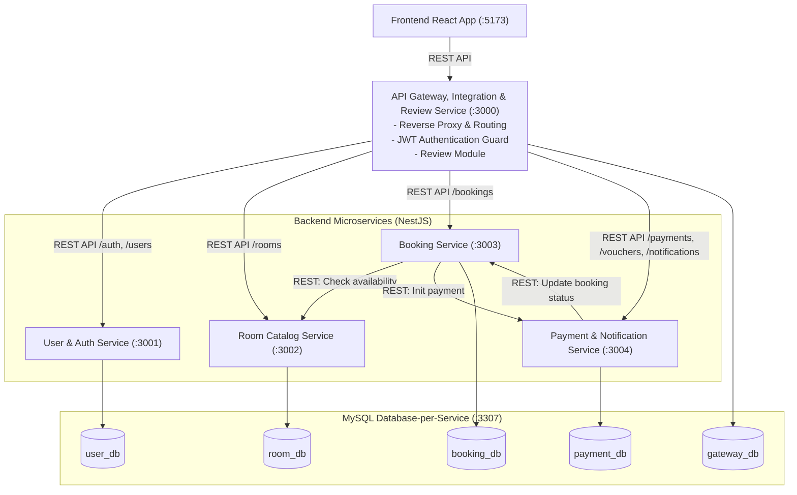

# 🏨 BOOKINGHOTEL - Hệ Thống Đặt Phòng Khách Sạn (Microservices)


<p align="center">
  <strong>Xây dựng hệ thống đặt phòng khách sạn BookingHotel theo kiến trúc Microservices</strong>
</p>

<p align="center">
  
  
  
  
  
  
</p>

---

## 📖 Giới thiệu tổng quan

**BookingHotel** là hệ thống đặt phòng khách sạn trực tuyến được xây dựng theo kiến trúc **Microservices**, bao gồm các phân hệ chính: **API Gateway (Integration & Review)**, **User & Auth**, **Room Catalog**, **Booking** và **Payment & Notification**.

Hệ thống cho phép người dùng đăng ký, đăng nhập, xem danh sách phòng, đặt phòng theo ngày, thanh toán (giả lập qua MoMo Sandbox / tại quầy) và quản lý lịch sử đặt phòng. Backend sử dụng **NestJS (TypeScript)**, Frontend dùng **React**, cơ sở dữ liệu **MySQL** với mô hình **Database-per-Service**, giao tiếp giữa các service qua **REST API**.

---

## 📋 Mục lục

1. [✨ Tính năng nổi bật](#-tính-năng-nổi-bật)
2. [🛠 Công nghệ sử dụng](#-công-nghệ-sử-dụng)
3. [🏗 Kiến trúc hệ thống & Danh sách Microservices](#-kiến-trúc-hệ-thống--danh-sách-microservices)
4. [🔄 Luồng nghiệp vụ chính](#-luồng-nghiệp-vụ-chính)
5. [👥 Phân công công việc (Nhóm 10)](#-phân-công-công-việc-nhóm-10)
6. [📁 Cấu trúc thư mục](#-cấu-trúc-thư-mục)
7. [🚀 Cài đặt & Khởi chạy dự án](#-cài-đặt--khởi-chạy-dự-án)
8. [⚙️ Cấu hình biến môi trường](#️-cấu-hình-biến-môi-trường)
9. [🛡️ Tài khoản dùng thử](#️-tài-khoản-dùng-thử)
10. [📡 Tài liệu API Endpoints](#-tài-liệu-api-endpoints)
11. [🌿 Git Workflow](#-git-workflow)
12. [📐 Quyết định thiết kế kiến trúc](#-quyết-định-thiết-kế-kiến-trúc)

---

## ✨ Tính năng nổi bật

### 1. Dành cho Khách hàng (Customer Web Portal)
- 🔍 **Tìm kiếm & Xem danh sách phòng:** Xem danh sách phòng trực quan, lọc theo loại phòng (`SINGLE`, `DOUBLE`, `DELUXE`, `SUITE`), lọc theo khoảng giá (`GET /api/rooms/price`) và trạng thái phòng trống.
- 📝 **Đặt phòng theo ngày:** Đặt phòng nhanh chóng theo ngày nhận - trả phòng, tự động tính số đêm lưu trú và tổng chi phí.
- 🏷️ **Áp dụng Mã giảm giá (Voucher):** Chọn nhanh hoặc nhập mã khuyến mãi để kiểm tra tính hợp lệ và chiết khấu trực tiếp vào tổng tiền thanh toán.
- 💳 **Thanh toán giả lập (Cổng MoMo Thẻ ATM nội địa Napas / Tiền mặt):**
  - Hỗ trợ thanh toán qua cổng MoMo Thẻ ATM nội địa Napas (`/payment/momo-atm` với xác thực OTP) hoặc đặt trước thanh toán tại quầy.
  - Tích hợp trang kết quả thanh toán Callback, tự động cập nhật trạng thái đơn đặt phòng và chống tạo trùng giao dịch `PENDING`.
  - Hỗ trợ **Thanh toán lại** trực tiếp từ trang *Lịch sử đặt phòng* nếu đơn đang ở trạng thái chờ (`PENDING`).
- 📱 **Quản lý lịch sử đặt phòng & Thẻ phòng điện tử (QR Code):** Theo dõi trạng thái đơn đặt phòng, hủy đơn và nhận mã QR Check-in điện tử sau khi đơn được xác nhận (`CONFIRMED`).
- ⭐ **Đánh giá & Phản hồi (Review Service):** Gửi đánh giá sao (1-5 ★) và nhận xét trải nghiệm trực tiếp từ lịch sử đặt phòng hoặc trang chi tiết phòng.
- 🔔 **Thông báo & Hồ sơ cá nhân:** Nhận thông báo xác nhận thanh toán / hoàn tiền trên thanh điều hướng và chỉnh sửa thông tin cá nhân (`/profile`).

### 2. Dành cho Quản trị viên (Admin Dashboard)
- 📊 **Thống kê doanh thu & Quản lý Voucher (Overview):** Thẻ KPI thống kê doanh thu thực tế từ Payment Service, biểu đồ doanh thu, phát hành/cập nhật số lượng mã giảm giá và theo dõi số lượt **Đã dùng / Còn lại**.
- 👥 **Quản lý Người dùng (User & Auth):** Xem danh sách tài khoản, cập nhật phân quyền (`ADMIN` / `CUSTOMER`) và xóa người dùng.
- 🏨 **Quản lý Danh mục phòng (Room Catalog):** Thêm phòng mới, chỉnh sửa thông tin phòng, xóa phòng và bật/tắt nhanh trạng thái phòng trống (`toggle-availability`).
- 📋 **Quản lý Đơn đặt phòng (Booking Management):** Theo dõi toàn bộ danh sách đặt phòng, xác nhận đơn (`CONFIRMED`) hoặc hủy đơn (`CANCELLED`).
- 💰 **Quản lý Giao dịch & Hoàn tiền (Payment & Refund Management):** Theo dõi lịch sử giao dịch thanh toán (`MOMO`, `CASH`), thực hiện **Hoàn tiền (`Refund`)** cho giao dịch thành công hoặc hủy giao dịch đang chờ.

---

## 🛠 Công nghệ sử dụng

| Phân hệ | Công nghệ | Chi tiết |
|:---|:---|:---|
| **Frontend** | React 18, TypeScript, Vite | Giao diện SPA hiện đại, tốc độ phản hồi nhanh |
| **Styling & UI** | Tailwind CSS, Recharts | Giao diện Responsive, biểu đồ thống kê doanh thu |
| **Backend** | NestJS 10 (TypeScript) | Kiến trúc hướng module, Dependency Injection |
| **ORM** | TypeORM | Tương tác cơ sở dữ liệu quan hệ, tự động đồng bộ schema |
| **Database** | MySQL 8.0 | Mô hình **Database-per-Service** (5 cơ sở dữ liệu độc lập) |
| **Giao tiếp nội bộ** | REST API (HTTP / Axios) | Giao tiếp đồng bộ giữa API Gateway và các Microservices |
| **Xác thực** | JWT (JSON Web Token), Bcrypt | Stateless Authentication, mã hóa mật khẩu an toàn |
| **Thanh toán** | MoMo ATM Napas Gateway (Sandbox) | Xử lý giao dịch thanh toán thẻ nội địa Napas và IPN/Callback |
| **Đóng gói & Triển khai** | Docker, Docker Compose | Đóng gói và khởi chạy đồng bộ toàn bộ hệ thống |

---

## 🏗 Kiến trúc hệ thống & Danh sách Microservices

### Sơ đồ kiến trúc tổng thể



### Danh sách các Microservices

| Service | Port | Database | Nhiệm vụ chính |
|:---|:---:|:---:|:---|
| **API Gateway, Integration & Review Service** | `3000` | `gateway_db` | Cổng giao tiếp trung tâm tiếp nhận request từ Frontend, định tuyến (Reverse Proxy) tới các service nội bộ qua REST API, xác thực JWT và quản lý đánh giá phòng (Review Service). |
| **User & Auth Service** | `3001` | `user_db` | Đăng ký, đăng nhập, cấp phát JWT Token, mã hóa mật khẩu Bcrypt, quản lý thông tin hồ sơ và phân quyền người dùng (`ADMIN` / `CUSTOMER`). |
| **Room Catalog Service** | `3002` | `room_db` | Quản lý danh sách phòng khách sạn, lọc phòng theo loại phòng và mức giá, kiểm tra tình trạng phòng trống (`availability`) phục vụ đặt phòng. |
| **Booking Service** | `3003` | `booking_db` | Lõi xử lý nghiệp vụ đặt phòng theo ngày, tính toán chi phí, kiểm tra phòng trống qua Room Service và quản lý vòng đời trạng thái đơn đặt (`PENDING` ➔ `CONFIRMED` / `FAILED` / `CANCELLED`). |
| **Payment & Notification Service** | `3004` | `payment_db` | Xử lý thanh toán (giả lập / MoMo Sandbox), quản lý mã giảm giá (Voucher), đồng bộ trạng thái thanh toán về Booking Service và gửi thông báo xác nhận. |
| **Frontend Web Client** | `5173` | N/A | Giao diện người dùng React cho Khách hàng đặt phòng và Bảng điều khiển Quản trị viên (Admin Dashboard). |

---

## 🔄 Luồng nghiệp vụ chính

### 1. Luồng Đặt phòng & Thanh toán (Booking & Payment Flow)
```
1. Người dùng xem danh sách phòng, chọn ngày nhận phòng (Check-in) và trả phòng (Check-out)
2. Frontend gửi request: POST /api/bookings qua API Gateway
3. API Gateway xác thực JWT và chuyển tiếp tới Booking Service
4. Booking Service gọi REST API sang Room Catalog Service: GET /rooms/:id/availability để kiểm tra phòng trống
5. Nếu phòng hợp lệ, Booking Service lưu đơn đặt phòng mới với trạng thái PENDING
6. Người dùng thực hiện thanh toán qua Payment & Notification Service (POST /api/payments)
7. Sau khi thanh toán hoàn tất, Payment Service gọi REST API cập nhật trạng thái đơn bên Booking Service thành CONFIRMED và tạo thông báo xác nhận
```

### 2. Luồng Đăng ký & Đăng nhập (User & Auth Flow)
```
1. Người dùng gửi thông tin đăng ký (POST /api/auth/register) hoặc đăng nhập (POST /api/auth/login)
2. API Gateway chuyển tiếp request đến User & Auth Service
3. User & Auth Service kiểm tra thông tin, đối chiếu mật khẩu đã băm (Bcrypt) và trả về chuỗi JWT Access Token
4. Frontend lưu trữ JWT và đính kèm vào Header (Authorization: Bearer <token>) cho các tác vụ đặt phòng, thanh toán và quản lý lịch sử
```

---

## 👥 Phân công công việc (Nhóm 10)

Bảng phân công nhiệm vụ các thành viên **Nhóm 10** theo đúng từng phân hệ Microservices:

| Nhóm | Họ và tên | Phân hệ phụ trách (Microservice) | Chi tiết công việc đảm nhiệm |
|:---:|:---|:---|:---|
| **10** | **Đậu Ngọc Anh** | **Payment & Notification Service (Thanh toán & Thông báo)** | Xây dựng dịch vụ xử lý thanh toán giả lập (MoMo Sandbox / Tiền mặt), xử lý callback cập nhật trạng thái đơn đặt phòng, quản lý mã giảm giá (Voucher) và module gửi thông báo (Notification). |
| **10** | **Bùi Đại Dương** | **User & Auth Service (Đăng nhập & Người dùng)** | Xây dựng dịch vụ đăng ký, đăng nhập, xác thực và cấp phát JWT Token, mã hóa mật khẩu bằng Bcrypt, các API quản lý thông tin tài khoản và phân quyền người dùng (`ADMIN` / `CUSTOMER`). |
| **10** | **Trần Đức Hải** | **Booking Service (Lõi Đặt phòng)** | Xây dựng dịch vụ lõi đặt phòng theo ngày, tính toán chi phí lưu trú, giao tiếp REST API với Room Service để kiểm tra phòng trống, quản lý lịch sử đặt phòng và trạng thái đơn (`PENDING`, `CONFIRMED`, `CANCELLED`). |
| **10** | **Nguyễn Thành Hưng** | **Room Catalog Service (Quản lý Phòng)** | Xây dựng dịch vụ quản lý danh mục phòng khách sạn (CRUD phòng), bộ lọc tìm kiếm theo loại phòng và khoảng giá, API kiểm tra và chuyển đổi trạng thái phòng khả dụng (`availability`). |
| **10** | **Trương Văn Phong** | **API Gateway, Integration & Review Service (Cổng giao tiếp & Đánh giá)** | Xây dựng cổng API Gateway định tuyến (Reverse Proxy) tích hợp toàn bộ các Microservices, cấu hình JWT Auth Guard tập trung, phát triển phân hệ đánh giá phòng (Review Service) và thiết lập Docker Compose. |

---

## 📁 Cấu trúc thư mục

```
booking_hotel-microservices/
├── api-gateway/                 # API Gateway, Integration & Review Service (Port: 3000)
│   ├── src/
│   │   ├── auth/                # JWT Auth Guard xác thực tập trung
│   │   ├── health/              # Kiểm tra trạng thái hoạt động của các services
│   │   ├── proxy/               # Reverse Proxy định tuyến REST API tới các services
│   │   ├── review/              # Quản lý đánh giá & nhận xét phòng (Review Service)
│   │   ├── app.module.ts
│   │   └── main.ts
│   ├── .env.example
│   ├── Dockerfile
│   └── package.json
│
├── user-service/                # User & Auth Service (Port: 3001)
│   ├── src/
│   │   ├── auth/                # Đăng ký, đăng nhập, cấp phát JWT
│   │   ├── users/               # Quản lý thông tin người dùng & phân quyền
│   │   └── main.ts
│   ├── .env.example
│   ├── Dockerfile
│   └── package.json
│
├── room-service/                # Room Catalog Service (Port: 3002)
│   ├── src/
│   │   ├── rooms/               # CRUD phòng, lọc phòng & kiểm tra phòng trống
│   │   └── main.ts
│   ├── .env.example
│   ├── Dockerfile
│   └── package.json
│
├── booking-service/             # Booking Service (Port: 3003)
│   ├── src/
│   │   ├── bookings/            # Lõi đặt phòng theo ngày & quản lý lịch sử đặt phòng
│   │   └── main.ts
│   ├── .env.example
│   ├── Dockerfile
│   └── package.json
│
├── payment-service/             # Payment & Notification Service (Port: 3004)
│   ├── src/
│   │   ├── payments/            # Thanh toán giả lập (MoMo Sandbox / Tiền mặt)
│   │   ├── vouchers/            # Quản lý mã giảm giá
│   │   ├── notifications/       # Quản lý & gửi thông báo
│   │   └── main.ts
│   ├── .env.example
│   ├── Dockerfile
│   └── package.json
│
├── frontend/                    # Frontend React Application (Port: 5173)
│   ├── src/
│   │   ├── components/          # Navbar, RoomCard, BookingSlideOver, PrivateRoute...
│   │   ├── pages/               # HomePage, RoomDetailPage, BookingPage, MyBookingsPage, AdminDashboardPage...
│   │   ├── context/             # AuthContext
│   │   ├── services/            # Axios REST API clients
│   │   └── types/               # TypeScript interfaces
│   ├── .env.example
│   ├── Dockerfile
│   └── package.json
│
├── docker-compose.yml           # Cấu hình khởi chạy toàn bộ hệ thống với Docker Compose
├── init.sql                     # Khởi tạo 5 cơ sở dữ liệu MySQL (Database-per-Service)
├── seed.sql                     # Dữ liệu phòng mẫu ban đầu
├── start-docker.bat             # Script khởi chạy nhanh bằng Docker trên Windows
├── start-all.bat                # Script khởi chạy môi trường dev cục bộ trên Windows
└── README.md
```

---

## 🚀 Cài đặt & Khởi chạy dự án

### Yêu cầu môi trường
- [Git](https://git-scm.com/)
- [Docker Desktop](https://www.docker.com/products/docker-desktop/) (Khuyến nghị để chạy đồng bộ toàn bộ hệ thống)
- [Node.js](https://nodejs.org/) >= 18 (Nếu chạy thủ công từng service trên máy)

---

### Cách 1: Khởi chạy bằng Docker Compose (Khuyến nghị)

```bash
# 1. Clone repository về máy
git clone https://github.com/k5phong0311-sketch/booking_hotel-microservices.git
cd booking_hotel-microservices

# 2. Khởi chạy toàn bộ hệ thống (MySQL, 5 Backend Services và Frontend)
docker-compose up --build -d

# 3. Kiểm tra trạng thái các containers
docker ps
```
*(Trên Windows có thể nhấp đúp trực tiếp vào file `start-docker.bat`)*

Sau khi khởi chạy thành công:
- 🌐 **Frontend React:** [http://localhost:5173](http://localhost:5173)
- 🔀 **API Gateway:** [http://localhost:3000/api](http://localhost:3000/api)
- 🗄️ **MySQL Database:** `localhost:3307` (User: `hotel_user` / Password: `hotel_password`)

---

### Cách 2: Khởi chạy thủ công cho môi trường Development

#### Bước 1: Khởi động cơ sở dữ liệu MySQL
```bash
docker-compose up -d mysql
```
> Tự động khởi tạo 5 database riêng biệt (`gateway_db`, `user_db`, `room_db`, `booking_db`, `payment_db`) thông qua file `init.sql`.

#### Bước 2: Khởi chạy các Microservices và Frontend
Trên Windows, bạn có thể chạy file `start-all.bat` hoặc khởi chạy từng thư mục (`api-gateway`, `user-service`, `room-service`, `booking-service`, `payment-service`, `frontend`):
```bash
cp .env.example .env
npm install
npm run start:dev   # (hoặc npm run dev đối với thư mục frontend)
```

---

## ⚙️ Cấu hình biến môi trường

### 1. API Gateway (`api-gateway/.env`)
```env
PORT=3000
DB_HOST=localhost
DB_PORT=3306
DB_USERNAME=hotel_user
DB_PASSWORD=hotel_password
DB_NAME=gateway_db
JWT_SECRET=super_secret_key_123
USER_SERVICE_URL=http://localhost:3001
ROOM_SERVICE_URL=http://localhost:3002
BOOKING_SERVICE_URL=http://localhost:3003
PAYMENT_SERVICE_URL=http://localhost:3004
```

### 2. User & Auth Service (`user-service/.env`)
```env
PORT=3001
DB_HOST=localhost
DB_PORT=3306
DB_USERNAME=hotel_user
DB_PASSWORD=hotel_password
DB_NAME=user_db
JWT_SECRET=super_secret_key_123
JWT_EXPIRES_IN=7d
```

### 3. Room Catalog Service (`room-service/.env`)
```env
PORT=3002
DB_HOST=localhost
DB_PORT=3306
DB_USERNAME=hotel_user
DB_PASSWORD=hotel_password
DB_NAME=room_db
```

### 4. Booking Service (`booking-service/.env`)
```env
PORT=3003
DB_HOST=localhost
DB_PORT=3306
DB_USERNAME=hotel_user
DB_PASSWORD=hotel_password
DB_NAME=booking_db
ROOM_SERVICE_URL=http://localhost:3002
PAYMENT_SERVICE_URL=http://localhost:3004
```

### 5. Payment & Notification Service (`payment-service/.env`)
```env
PORT=3004
DB_HOST=localhost
DB_PORT=3306
DB_USERNAME=hotel_user
DB_PASSWORD=hotel_password
DB_NAME=payment_db
BOOKING_SERVICE_URL=http://localhost:3003
USER_SERVICE_URL=http://localhost:3001
```

### 6. Frontend Client (`frontend/.env`)
```env
VITE_API_URL=http://localhost:3000/api
```

---

## 🛡️ Tài khoản dùng thử & Thẻ Test MoMo Sandbox

### 1. Tài khoản hệ thống
| Vai trò | Email đăng nhập | Mật khẩu | Quyền hạn và Chức năng |
|:---|:---|:---|:---|
| **Quản trị viên (Admin)** | `admin@bookinghotel.com` | `admin123` | Truy cập Admin Dashboard, xem thống kê doanh thu, quản lý phòng, duyệt/hủy đơn đặt phòng và quản lý người dùng. |
| **Khách hàng (Customer)** | `customer@bookinghotel.com` | `123456` | Xem danh sách phòng, đặt phòng theo ngày, áp dụng voucher, thanh toán giả lập, quản lý lịch sử đặt phòng và đánh giá phòng. |

### 2. Thông tin thẻ ATM nội địa Napas Test trên cổng MoMo
Khi chọn phương thức **Thanh toán MoMo (Thẻ nội địa ATM)**, sử dụng bộ thẻ Napas test dưới đây:

| Trường thông tin | Giá trị nhập | Ghi chú |
|:---|:---|:---|
| **Số thẻ Napas** | `9704000000000018` | Thẻ ATM nội địa Napas (Kịch bản: Thanh toán thành công) |
| **Ngày phát hành (MM/YY)** | `03/07` | Tháng 03 / Năm 07 |
| **Tên chủ thẻ** | `NGUYEN VAN A` | Viết hoa không dấu |
| **Số điện thoại** | `0901234567` | 10 chữ số bất kỳ |
| **Mã xác thực OTP** | `123456` | Hoặc `OTP` |

---

## 📡 Tài liệu API Endpoints

Mọi request từ Frontend đều đi qua **API Gateway** tại `http://localhost:3000/api`.

### 1. User & Auth Service (`/api/auth`, `/api/users`)
| Phương thức | Endpoint | Mô tả | Xác thực JWT |
|:---|:---|:---|:---:|
| `POST` | `/api/auth/register` | Đăng ký tài khoản mới | ❌ |
| `POST` | `/api/auth/login` | Đăng nhập và nhận JWT Token | ❌ |
| `GET` | `/api/users` | Lấy danh sách toàn bộ người dùng (Admin) | ✅ |
| `GET` | `/api/users/:id` | Xem thông tin chi tiết người dùng | ✅ |
| `PATCH` | `/api/users/:id` | Cập nhật thông tin / phân quyền người dùng | ✅ |
| `DELETE` | `/api/users/:id` | Xóa người dùng | ✅ |

### 2. Room Catalog Service (`/api/rooms`)
| Phương thức | Endpoint | Mô tả | Xác thực JWT |
|:---|:---|:---|:---:|
| `GET` | `/api/rooms` | Lấy danh sách phòng (hỗ trợ lọc `?type=...`) | ❌ |
| `GET` | `/api/rooms/price` | Lọc phòng theo khoảng giá (`?min=...&max=...`) | ❌ |
| `GET` | `/api/rooms/:id` | Xem chi tiết thông tin phòng | ❌ |
| `GET` | `/api/rooms/:id/availability`| Kiểm tra phòng trống và lấy đơn giá | ❌ |
| `POST` | `/api/rooms` | Thêm phòng mới (Admin) | ✅ |
| `PATCH` | `/api/rooms/:id` | Cập nhật thông tin phòng (Admin) | ✅ |
| `PATCH` | `/api/rooms/:id/toggle-availability` | Đổi trạng thái phòng trống / đã đặt | ✅ |
| `DELETE` | `/api/rooms/:id` | Xóa phòng (Admin) | ✅ |

### 3. Booking Service (`/api/bookings`)
| Phương thức | Endpoint | Mô tả | Xác thực JWT |
|:---|:---|:---|:---:|
| `GET` | `/api/bookings` | Lấy tất cả đơn đặt phòng toàn hệ thống (Admin) | ✅ |
| `POST` | `/api/bookings` | Đặt phòng mới theo ngày | ✅ |
| `GET` | `/api/bookings/user/:userId` | Xem lịch sử đặt phòng của người dùng | ✅ |
| `GET` | `/api/bookings/:id` | Xem chi tiết đơn đặt phòng | ✅ |
| `PATCH` | `/api/bookings/:id/confirm` | Xác nhận đơn đặt phòng (Admin) | ✅ |
| `PATCH` | `/api/bookings/:id/cancel` | Hủy đơn đặt phòng | ✅ |
| `PATCH` | `/api/bookings/:id/status` | Cập nhật trạng thái đơn đặt phòng | ✅ |

### 4. Payment & Notification Service (`/api/payments`, `/api/vouchers`, `/api/notifications`)
| Phương thức | Endpoint | Mô tả | Xác thực JWT |
|:---|:---|:---|:---:|
| `POST` | `/api/payments` | Khởi tạo giao dịch thanh toán (MoMo ATM Napas / Tiền mặt) | ✅ |
| `POST` | `/api/payments/momo/ipn` | Nhận kết quả callback thanh toán MoMo | ❌ |
| `GET` | `/api/payments` | Xem danh sách giao dịch thanh toán (Admin) | ✅ |
| `GET` | `/api/payments/stats/summary`| Thống kê doanh thu thực tế và số lượng giao dịch | ✅ |
| `GET` | `/api/payments/booking/:bookingId` | Tra cứu thanh toán theo mã đặt phòng | ✅ |
| `GET` | `/api/payments/user/:userId` | Lịch sử giao dịch của người dùng | ✅ |
| `POST` | `/api/payments/:id/refund` | Hoàn tiền giao dịch & hủy đơn đặt phòng (Admin) | ✅ |
| `POST` | `/api/payments/:id/cancel` | Hủy giao dịch đang chờ thanh toán (Admin) | ✅ |
| `GET` | `/api/vouchers` | Lấy danh sách mã giảm giá (đã dùng / còn lại) | ❌ |
| `POST` | `/api/vouchers/broadcast` | Phát hành mới hoặc cập nhật số lượng mã giảm giá (Admin) | ✅ |
| `POST` | `/api/vouchers/apply` | Kiểm tra và áp dụng mã giảm giá (Pessimistic Lock) | ✅ |
| `DELETE` | `/api/vouchers/:id` | Xóa / thu hồi mã giảm giá (Admin) | ✅ |
| `GET` | `/api/notifications/user/:userId` | Lấy danh sách thông báo của người dùng | ✅ |
| `PATCH` | `/api/notifications/:id/read` | Đánh dấu thông báo đã đọc | ✅ |

### 5. Review Service (`/api/reviews`)
| Phương thức | Endpoint | Mô tả | Xác thực JWT |
|:---|:---|:---|:---:|
| `POST` | `/api/reviews` | Gửi đánh giá phòng | ✅ |
| `GET` | `/api/reviews/room/:roomId` | Xem danh sách đánh giá theo phòng | ❌ |
| `GET` | `/api/reviews/:id` | Xem chi tiết một đánh giá | ❌ |
| `DELETE` | `/api/reviews/:id` | Xóa đánh giá (Admin) | ✅ |

---

## 🌿 Git Workflow

Dự án áp dụng **Feature Branch Workflow** theo từng phân hệ Microservice:
- `feat/api-gateway` — **Trương Văn Phong** (API Gateway, Integration & Review Service)
- `feat/user-auth` — **Bùi Đại Dương** (User & Auth Service)
- `feat/booking-service` — **Trần Đức Hải** (Booking Service)
- `feat/room-catalog` — **Nguyễn Thành Hưng** (Room Catalog Service)
- `feat/payment-notification` — **Đậu Ngọc Anh** (Payment & Notification Service)

---

## 📐 Quyết định thiết kế kiến trúc

| # | Khía cạnh | Quyết định kỹ thuật | Lý do lựa chọn (Rationale) |
|:---:|:---|:---|:---|
| **1** | **Tách biệt dữ liệu** | **Database-per-Service** (5 DB MySQL riêng) | Đảm bảo tính độc lập dữ liệu (Loose Coupling) giữa các Microservices; một service không thể truy cập trực tiếp bảng của service khác. |
| **2** | **Giao tiếp giữa các Service** | **REST API (HTTP)** | Dễ triển khai, dễ kiểm thử và minh bạch trong luồng gọi liên dịch vụ (Booking ↔ Room, Booking ↔ Payment). |
| **3** | **Điểm truy cập tập trung** | **API Gateway Pattern** | Frontend chỉ cần giao tiếp với một địa chỉ duy nhất (`:3000`), giúp ẩn cấu trúc mạng nội bộ và kiểm soát xác thực JWT tập trung. |
| **4** | **Cơ chế xác thực** | **Stateless JWT** | Không lưu trữ session trên server, giúp các Microservices xác thực nhanh và dễ dàng mở rộng (scale). |

---

<p align="center">
  Đồ án Xây dựng hệ thống đặt phòng khách sạn BookingHotel theo kiến trúc Microservices — Thực hiện bởi <strong>Nhóm 10</strong>
</p>
